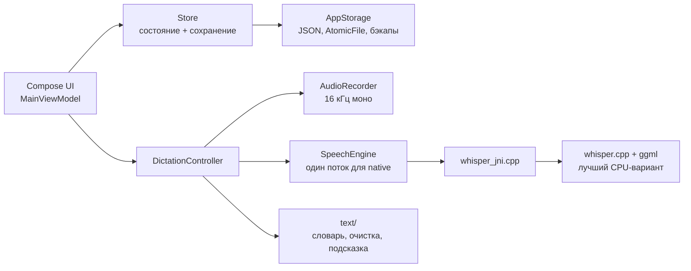

# Архитектура

Приложение для Android на Kotlin и Jetpack Compose (Material 3). Распознавание речи — whisper.cpp через JNI. Всё работает на телефоне, интернет нужен один раз, чтобы скачать модель.

## Пакеты

| Пакет | Что внутри |
|---|---|
| `data` | модель данных (`Model.kt`), чистые операции над ней (`DataOps`), хранение на диске (`AppStorage`), состояние в памяти (`Store`) |
| `text` | обработка текста: словарь с русскими окончаниями, очистка «галлюцинаций» Whisper, подсказка для модели, поиск исправлений пользователя, разбор ввода на записи |
| `speech` | JNI-мост (`WhisperNative`), загрузка модели (`ModelDownloader`), запись звука (`AudioRecorder`), движок (`SpeechEngine`), сценарий диктовки (`DictationController`) |
| `ui` | экраны и компоненты Compose, `MainViewModel` |
| `cpp` | `whisper_jni.cpp` и CMake-сборка whisper.cpp |

## Данные

- Все изменения — чистые функции `DataOps`. Они возвращают новый `AppData` и покрыты тестами (`app/src/test`).
- `Store` держит состояние в `StateFlow`. Файл пишется через 300 мс после последнего изменения, а при сворачивании приложения — сразу.
- Файлы лежат в `files/data/` приложения: `data.json`, `settings.json`, `backups/`.
  - Запись атомарная, через `AtomicFile`.
  - Если файл повреждён, загружается последняя исправная копия, а сам повреждённый файл сохраняется рядом.
- Удаление идёт через корзину с `batchId`, поэтому одно «Отменить» возвращает всё, что удалено одним действием.
- JSON настроен терпимо: неизвестные поля пропускаются, неизвестные значения перечислений заменяются значениями по умолчанию. Новые версии приложения читают старые файлы.

## Распознавание речи

Модель выбрана по тесту из [ASR-BENCHMARK.md](ASR-BENCHMARK.md): **Whisper Large-v3-Turbo, 8 бит** (874 МБ). Язык `ru`, подсказка о стиле плюс слова из словаря, VAD Silero.

- **Сборка whisper.cpp.** ggml собирается со всеми CPU-вариантами для Android (`GGML_CPU_ALL_VARIANTS`): от armv8.0 до armv9.2 с SVE2 и SME. При запуске загружается лучший вариант для процессора телефона. Нативный код всегда собирается с `-O3`: без этого whisper.cpp на Android работает в десятки раз медленнее.
- **Загрузка модели в память.** Модель загружается в фоне, когда приложение открывается или начинается запись, чтобы диктовка не ждала. После сворачивания приложения модель выгружается через заданное время, чтобы освободить около 1 ГБ памяти.
- **Быстрый режим.** Whisper всегда обрабатывает окно в 30 секунд. Для короткой фразы окно кодировщика сокращается до её длины плюс 2 секунды (`audio_ctx`), и короткие фразы распознаются в разы быстрее.
- **Обработка текста после распознавания.** Удаляются выдуманные моделью субтитры («Продолжение следует…»), применяется словарь. Если пользователь исправил текст перед сохранением, приложение сравнивает версии по словам и предлагает запомнить исправление.

## Как расширять

- **Новый тип вкладки** (канбан, таблица): значение в `TabKind`, своя ветка отрисовки в `ItemList`.
- **Новое поле записи** (теги, напоминания): поле со значением по умолчанию в `Item`, операция в `DataOps`, тест. Старые файлы читаются без миграции.
- **Синхронизация между устройствами:** у сущностей есть UUID, `createdAt` и `updatedAt`, удаление идёт через корзину. Это основа для слияния изменений.
- **Ускорение на NPU** (например, Qualcomm QNN для Snapdragon): ещё одна реализация за `SpeechEngine`, остальное приложение не меняется.
- **Глобальный голосовой ввод в любое приложение** (клавиатура или виджет): `DictationController` уже отделён от экрана.
