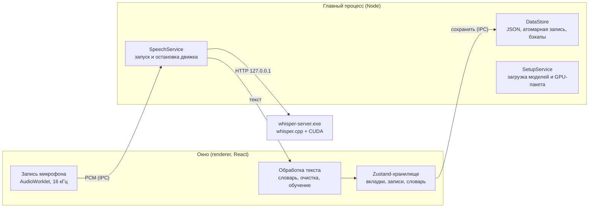

# Архитектура

Органайзер задач — настольное приложение для Windows на Electron. Все данные и распознавание речи остаются на компьютере, интернет нужен только один раз, чтобы скачать модель.

## Слои

| Папка | Что внутри | Правило |
|---|---|---|
| `src/shared` | модель данных, операции над данными, обработка текста, каталог моделей, контракт IPC | чистый TypeScript без Electron и DOM; используется обеими сторонами и тестами |
| `src/main` | окно, файлы, процессы, загрузки | единственное место с доступом к диску и процессам |
| `src/preload` | мост `window.api` | только пробрасывает вызовы, без логики |
| `src/renderer` | интерфейс на React | работает с данными только через `window.api` |

Окно запускается в песочнице (`sandbox`, `contextIsolation`) и не может открывать сайты или новые окна. Политика CSP запрещает загрузку чего-либо извне.

## Данные

- Модель данных описана в [`src/shared/model.ts`](../src/shared/model.ts): вкладки (`Tab`), записи (`Item`), корзина (`TrashEntry`), словарь (`DictionaryTerm`).
- Все изменения проходят через функции [`src/shared/dataOps.ts`](../src/shared/dataOps.ts). Они меняют переданный объект: интерфейс вызывает их внутри immer-черновика, тесты — на обычных объектах.
- Состояние хранится в окне. Изменения сохраняются через 300 мс после последнего действия, а при закрытии окна — синхронно.
- Главный процесс проверяет каждое сохранение схемой zod ([`src/shared/schema.ts`](../src/shared/schema.ts)) и пишет файл атомарно: сначала временный файл, потом переименование. Если файл повреждён, загружается последний исправный бэкап. Бэкапы делаются раз в день, хранятся последние 14.
- У файлов есть `schemaVersion`, а у загрузки — точка миграции `migrateData()`. Новые поля добавляются без потери старых данных.

Где лежат файлы:

| Что | Путь |
|---|---|
| данные и настройки | `%APPDATA%\TaskOrganizer\` (`data.json`, `settings.json`, `backups\`) |
| модели речи | `%LOCALAPPDATA%\TaskOrganizer\models\` |
| движок whisper.cpp | `%LOCALAPPDATA%\TaskOrganizer\runtime\whisper-<сборка>\` |

Пути из латиницы выбраны специально: whisper.cpp на Windows ненадёжно открывает файлы с кириллицей в пути. Поэтому модель передаётся движку относительным путём от рабочей папки процесса.

## Распознавание речи

Почему именно эта модель, описано в [ASR-BENCHMARK.md](ASR-BENCHMARK.md).

1. Окно записывает микрофон через AudioWorklet и пересэмплирует звук в 16 кГц моно (`OfflineAudioContext`).
2. Как только начинается запись, окно вызывает `speech.prepare()`. Главный процесс запускает `whisper-server.exe`, и модель грузится в видеопамять, пока человек говорит.
3. После остановки PCM уходит в главный процесс, превращается в WAV и отправляется POST-запросом на `http://127.0.0.1:<порт>/inference` с языком, подсказкой и включённым VAD.
4. Окно чистит ответ от «галлюцинаций» Whisper, применяет словарь замен и показывает текст в поле ввода.
5. Если пользователь исправил текст перед сохранением, приложение сравнивает версии и предлагает запомнить исправление в словаре.

Движок живёт отдельным процессом: его падение не роняет приложение, а модель не нужно загружать заново для каждой фразы. Через 15 минут без диктовки (время настраивается) процесс останавливается и освобождает видеопамять, чтобы ноутбук не тратил батарею.

Ускорение на видеокарте. В приложение входит сборка whisper.cpp для процессора (около 15 МБ). GPU-пакет с CUDA и cuBLAS весит около 1,2 ГБ, поэтому скачивается отдельно из настроек. ggml сам подхватывает `ggml-cuda.dll`, если она лежит рядом с `whisper-server.exe`. Если видеокарта не запустилась, приложение повторяет попытку на процессоре.

Новые движки добавляются за интерфейсом `SpeechEngine` в `src/main/speech`. Каталог моделей лежит в [`src/shared/speechModels.ts`](../src/shared/speechModels.ts), версия и хэши whisper.cpp — в [`src/shared/whisperRuntime.json`](../src/shared/whisperRuntime.json).

## Как расширять

- **Новый тип вкладки** (канбан, таблица): добавить значение в `TabKind`, компонент в `src/renderer/src/features/tabs/views` и строку в реестр видов вкладки.
- **Новое поле записи** (теги, напоминания): поле в `Item`, правило в `schema.ts` с `.catch()` для старых файлов, операция в `dataOps.ts` и тест.
- **Синхронизация между устройствами:** у всех сущностей уже есть `id` (UUID), `createdAt` и `updatedAt`, а удаление идёт через корзину. Это основа для слияния изменений.
- **Хранилище SQLite** вместо JSON: заменить `DataStore` в `src/main/storage`, контракт IPC не меняется.
- **Мобильная версия:** `src/shared` переносится без изменений, интерфейс на React можно запустить в Capacitor, а речь — через whisper.cpp для Android.
- **Другой язык интерфейса:** все строки интерфейса собраны в `src/renderer/src/i18n/ru.ts`.
