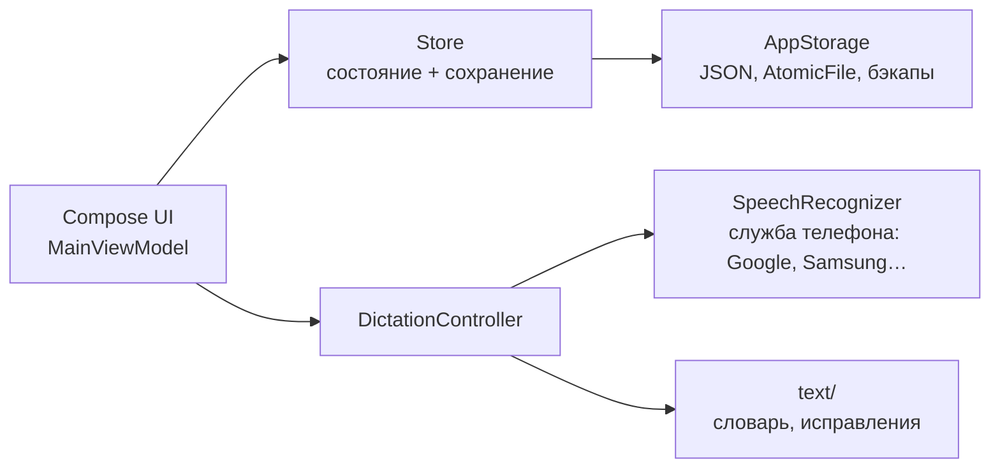

# Архитектура

Приложение для Android на Kotlin и Jetpack Compose (Material 3). Речь распознаёт системная служба Android через `SpeechRecognizer`. Своих моделей и нативного кода в приложении нет, и интернет ему не нужен: разрешения на него нет.

## Пакеты

| Пакет | Что внутри |
|---|---|
| `data` | модель данных (`Model.kt`), чистые операции над ней (`DataOps`), хранение на диске (`AppStorage`), состояние в памяти (`Store`) |
| `text` | обработка текста: словарь с русскими окончаниями, поиск исправлений пользователя, разбор ввода на записи |
| `speech` | диктовка через `SpeechRecognizer` (`DictationController`), службы распознавания на телефоне (`RecognitionServices`) |
| `ui` | экраны и компоненты Compose, `MainViewModel` |

## Данные

- Все изменения — чистые функции `DataOps`. Они возвращают новый `AppData` и покрыты тестами (`app/src/test`).
- `Store` держит состояние в `StateFlow`. Файл пишется через 300 мс после последнего изменения, а при сворачивании приложения — сразу.
- Файлы лежат в `files/data/` приложения: `data.json`, `settings.json`, `backups/`.
  - Запись атомарная, через `AtomicFile`.
  - Если файл повреждён, загружается последняя исправная копия, а сам повреждённый файл сохраняется рядом.
- Удаление идёт через корзину с `batchId`, поэтому одно «Отменить» возвращает всё, что удалено одним действием.
- JSON настроен терпимо: неизвестные поля пропускаются, неизвестные значения перечислений заменяются значениями по умолчанию. Новые версии приложения читают старые файлы.

## Распознавание речи

- **Служба.** По умолчанию — служба распознавания, выбранная в Android. В настройках можно выбрать любую установленную службу (`android.speech.RecognitionService`) или распознаватель Android 12+ на устройстве. Чтобы приложение видело службы на Android 11+, в манифесте объявлен `<queries>`.
- **Без интернета.** Запрос идёт с `EXTRA_PREFER_OFFLINE`: служба распознаёт только на телефоне. Если у неё нет языка для работы без сети, приложение говорит, что делать. Переключатель «Только без интернета» в настройках снимает это ограничение.
- **Скорость.** Распознавание потоковое: частичный текст (`onPartialResults`) виден во время речи, финальный приходит сразу после паузы или нажатия на кнопку.
- **Английские названия.** Системные службы часто пишут их по-русски («гитхаб»). Словарь заменяет такие слова с учётом падежей, а исправления пользователя приложение предлагает запомнить. На Android 13+ слова из словаря передаются службе как подсказки (`EXTRA_BIASING_STRINGS`); службы без их поддержки подсказки игнорируют.
- **Надёжность.** Для каждой фразы создаётся новый `SpeechRecognizer`, поздние ответы старого игнорируются. Если служба вернула ошибку или не прислала финальный текст за 8 секунд, сохраняется уже распознанный частичный текст.

История: первая версия распознавала речь моделью Whisper Large-v3-Turbo через whisper.cpp внутри приложения. На Galaxy S26 (Exynos 2600) модель работала только на процессоре, была медленной и неточной на живой речи, поэтому её заменили системной службой.

## Как расширять

- **Новый тип вкладки** (канбан, таблица): значение в `TabKind`, своя ветка отрисовки в `ItemList`.
- **Новое поле записи** (теги, напоминания): поле со значением по умолчанию в `Item`, операция в `DataOps`, тест. Старые файлы читаются без миграции.
- **Синхронизация между устройствами:** у сущностей есть UUID, `createdAt` и `updatedAt`, удаление идёт через корзину. Это основа для слияния изменений.
- **Другой распознаватель** (например, своя офлайн-модель): другая реализация с теми же `phase`, `partial`, `results`, что у `DictationController`; экран не меняется.
- **Глобальный голосовой ввод в любое приложение** (клавиатура или виджет): `DictationController` уже отделён от экрана.
